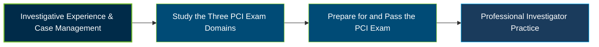

# ASIS Professional Certified Investigator (PCI) Certification Exam Guide

A dedicated study guide and investigative knowledge reference for professionals preparing for the **ASIS Professional Certified Investigator (PCI®) Certification Exam**, covering professional responsibility, investigative techniques, evidence management, and case presentation.

---

## Exam Overview

The ASIS Professional Certified Investigator (PCI) certification validates professional knowledge and experience in managing investigations, collecting and preserving evidence, and preparing reports and testimony to substantiate investigative findings.

- **Exam Format**: Multiple-choice examination, available at a testing center or through approved remote proctoring.
- **Target Audience**: Professional investigators, security specialists, investigation managers, and professionals responsible for case management and evidence collection.
- **Prerequisites**: Three to five years of investigations experience, including at least two years in case management. The required experience varies by education and applicable APP credential status.

---

## Core Exam Domains & Knowledge Areas

### 1. Professional Responsibility

- Investigative ethics, conflicts of interest, applicable laws, regulations, and professional responsibilities.
- Case assessment, investigative objectives, risk analysis, and strategy development.
- Resource management, case documentation, and continuous investigative process improvement.

### 2. Investigative Techniques & Procedures

- Physical, behavioral, and electronic surveillance, including planning, authorization, and documentation.
- Interview techniques, evidence collection, preservation, and chain of custody.
- Research methods, external agency collaboration, forensic analysis, and specialized investigative techniques.

### 3. Case Presentation

- Preparing clear investigative reports that substantiate findings and address confidentiality and legal considerations.
- Organizing investigative information using accurate terminology and logical sequencing.
- Preparing for and presenting testimony in administrative, civil, and criminal proceedings.

---

## Certification Path

---

## Recommended Practice & Study Resources

Use official ASIS materials alongside practical investigative exercises to build a clear understanding of the PCI examination domains.

- **CertsGate**: Explore [ASIS PCI certification preparation resources](https://certsgate.com/exams/asis/asis-pci) for supplementary study materials and practice opportunities.
- **Practical Investigative Study**: Apply investigative concepts through case-based exercises involving surveillance planning, interviews, evidence preservation, chain of custody, investigative reports, and testimony. Review the [ASIS PCI Reference Set](https://store.asisonline.org/pci-reference-set.html) to support this work.
